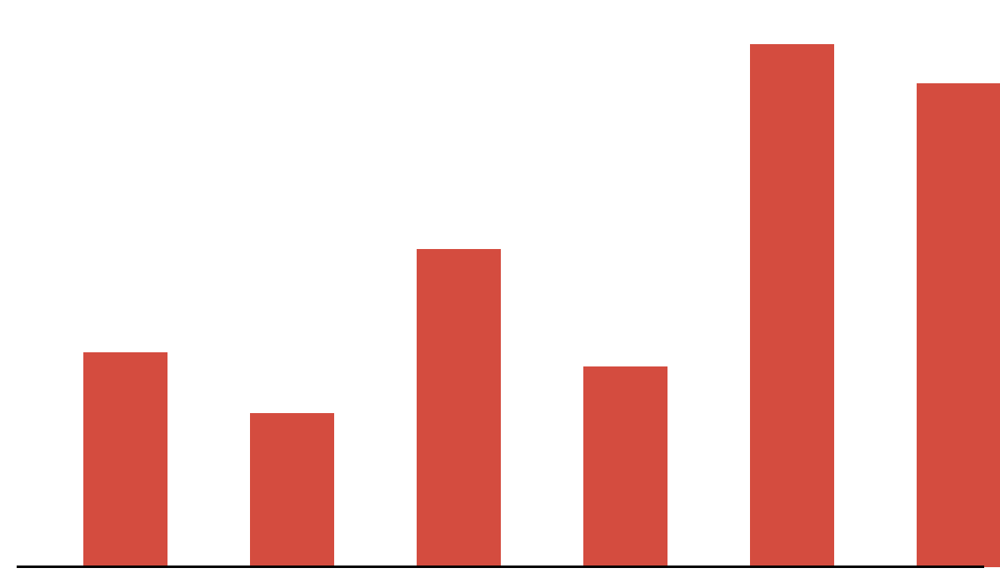
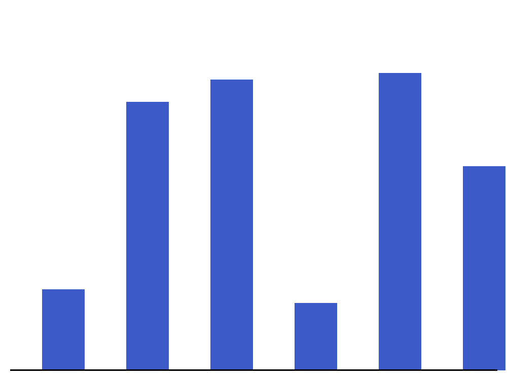
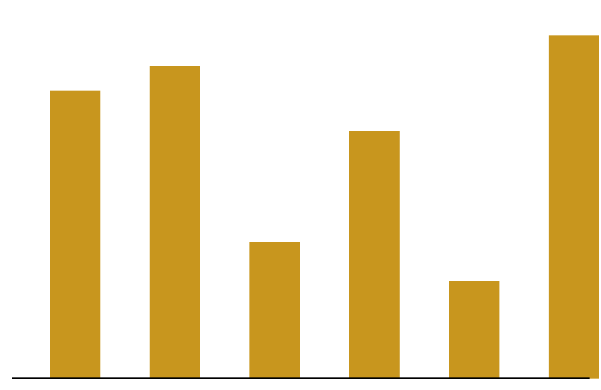
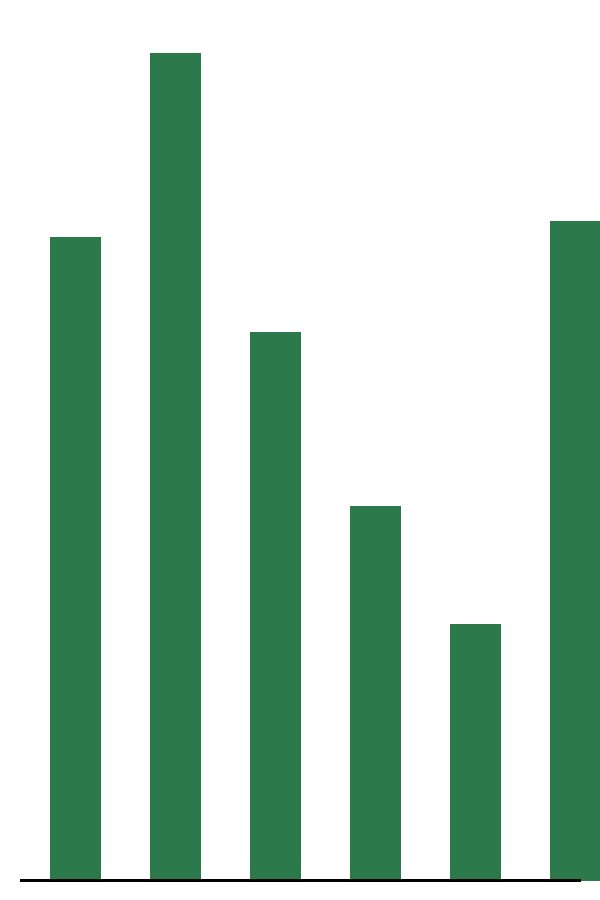

# Renewable Energy Outlook for West Africa 2026

This report reviews solar and wind adoption across West Africa, with a focus on Nigeria, Ghana and Senegal.

## Executive Summary

Solar capacity in the region grew faster than any other energy source in 2025. Falling panel prices, diesel costs and new mini-grid regulation pushed commercial and residential buyers toward solar. Grid reliability remains the main driver: businesses in Lagos report an average of 8 hours of outages per day. Financing is the largest remaining barrier, as most buyers still pay upfront.

Figure 1: Installed solar capacity by country, 2020-2025.

## Key Figures

- Installed capacity: 4.2 GW across the region
- 63% of new installations were commercial rooftop
- ₦1.8 trillion invested in mini-grids since 2021

## Market Size by Country

Nigeria leads by absolute capacity, while Senegal has the highest share of renewables in its grid mix.

| Country | Capacity (MW) | Share of grid | Growth 2025 |
|---|---|---|---|
| Nigeria | 1,850 | 6% | 31% |
| Ghana | 980 | 9% | 22% |
| Senegal | 760 | 24% | 18% |
| Côte d'Ivoire | 610 | 7% | 27% |

## 3 Methodology

## 3.1 Data Sources

We combined customs import data for solar panels, installer surveys from 420 companies, and utility grid reports. Survey responses were weighted by installer size.

## Regional Gallery

Figure 2: A 200 kW mini-grid in Kaduna State.

Figure 3: Rooftop installation on a Lagos warehouse.

## Barriers to Adoption

The barriers below came up most often in installer interviews.

1. Upfront cost of systems, especially batteries, which make up nearly half of a typical commercial quote.
2. Limited consumer financing options, as banks rarely lend against solar assets.
3. Import duties and foreign-exchange volatility that make pricing unpredictable for installers.
4. A shortage of trained technicians outside major cities.

## Detailed Discussion

Solar adoption in the region has followed a pattern familiar from East Africa, but with important differences. The first wave of buyers were large commercial users such as telecom tower operators, banks and manufacturers who had been running diesel generators for decades. For these buyers the economics were straightforward: solar plus storage replaced a large share of diesel spend with a payback period of three to four years. The second wave, now underway, is driven by small and medium businesses and middle-income households. These buyers are far more price sensitive and depend on financing. Pay-as-you-go models, which allow customers to pay in small instalments through mobile money, have expanded quickly in Ghana and Nigeria. However, currency depreciation has squeezed the margins of companies that import equipment in dollars but collect revenue in local currency. Several providers have responded by raising prices or shortening loan terms, which slows adoption among the customers who need it most. Policy is also shifting. Nigeria's Electricity Act of 2023 allowed states to regulate their own electricity markets, opening the door for state-level mini-grid programmes. Early results are promising: Lagos, Ogun and Kaduna states have all announced procurement programmes. Ghana has focused on net metering, while Senegal has prioritised utility-scale solar parks that feed directly into the national grid. Each approach has trade-offs. Distributed systems reach customers faster but are harder to finance at scale, while utility-scale projects attract development finance but depend on a reliable transmission network. Looking ahead, battery prices are expected to keep falling, which will make solar plus storage competitive with diesel for almost every commercial user by 2028. The main uncertainty is financing: without affordable credit, many households will remain locked out of the transition even as the technology becomes cheaper.

### Outlook

We expect regional capacity to double by 2028 if current policy support continues.
